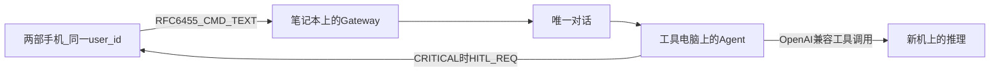

# 手机与个人电脑通过大模型融合的实现流程

本文是实现设计，不是已完成系统的测试报告。仓库里还没有的行为，都写成待实现步骤。文献和文档只使用已经核对过、并且版本对得上的来源。

## 1. 要做成的事

人不再亲手操作个人电脑。手机不是电脑桌面的显示器，也不是一份机器人列表。手机上只有一条和同一个人绑定的对话。大模型是这条对话的唯一对方。模型再去调用电脑上的文件、命令和推理资源。

这和两种常见做法不同。

远程桌面把电脑画面搬到手机上，点击和键盘仍然由人发出。人还是在操作电脑，手机只是一块屏幕。

即时通讯里的机器人要求人先选中某一个机器人，再对它说话。多个机器人就是多个入口。人要知道工作该交给谁。

灵机要做成的是第三条：人只对模型说话。模型决定这件事落在哪一台电脑、要不要先征得同意。手机上出现的批准，是同一条对话里的一次确认，不是打开电脑界面，也不是改去跟另一个机器人说话。

本设计不替换手机操作系统，也不替换电脑操作系统。替换的是人与这两类设备之间的操作关系。

## 2. 现有代码已经做到哪一步

手机命令行客户端发送 `CMD_TEXT` 时不携带 `target_agent_id`，见 [lingji-phone/phone_client.py](../../lingji-phone/phone_client.py)。Gateway 在缺少该字段时把消息交给固定标识 `lingji-pc`，见 [lingji-gateway/handler/routing.go](../../lingji-gateway/handler/routing.go)。因此今天的手机路径已经没有“点选机器人”，但它也还没有“按任务把工作放到合适的电脑上”。三台电脑会被压成一台默认电脑。

认证报文可以带 `user_id`。没带时，Gateway 把 `user_id` 设成这台设备自己的 `device_id`，见 [lingji-gateway/handler/ws.go](../../lingji-gateway/handler/ws.go)。两部手机如果各用各的设备号、又不写同一个 `user_id`，就会被看成两个用户。

危险操作已经能在手机上批准或拒绝，消息类型是 `HITL_REQ` 与 `HITL_RES`。这是同一条链路上的确认，应当保留。它不是让人去操作电脑桌面。

`CMD_LIST_SESSIONS` 和 `CMD_HERMES_SESSION` 会把人带回“选择某一个会话或某一台控制面”的路径。它们可以留在维护接口里，不能出现在手机的日常入口。

推理配置写的是 OpenAI 兼容接口，模型名为 `deepseek-chat`，见 [lingji-agent/src/lingji_agent/foundation/config.py](../../lingji-agent/src/lingji_agent/foundation/config.py)。本地 CUDA 运行时还没有版本号，不能把它写成已经安装。

## 3. 规范与版本

实现时只依赖下表。左边是规范或发布，右边是仓库里已经写明的版本，或者本文明确选作设计版本的修订。对不上的文档不引用、不照着实现。

| 事项 | 采用的规范 | 版本如何对上 |
| --- | --- | --- |
| 传输 | IETF RFC 6455，The WebSocket Protocol | Gateway 使用 Go 1.23.4 与 `gorilla/websocket v1.5.3`，见 [lingji-gateway/go.mod](../../lingji-gateway/go.mod)。协议版本与库版本分开写 |
| 业务消息 | 现有 `Message`：`msg_id`、`msg_type`、`device_id`、`timestamp`、`payload` | Go 与 Python 已有互操作测试。不另造第二套信封 |
| 工具调用 | OpenAI 兼容的 Chat Completions 工具字段 | Python 依赖为 `openai>=1.0`，见 [lingji-agent/pyproject.toml](../../lingji-agent/pyproject.toml)。动手改推理前，先把解析后的具体版本写进锁文件，再对照该版本的工具字段 |
| 智能体循环 | 仓库已依赖的 LangGraph | `langgraph>=1.0`，检查点库 `langgraph-checkpoint-sqlite>=2.0`。不引用不带版本号的最新文档站 |
| 向量记忆 | Chroma | `chromadb>=0.5,<1.0` |
| 链路追踪 | OpenTelemetry | Python API 为 `opentelemetry-api>=1.27`。采集器镜像是 `otel/opentelemetry-collector-contrib:0.96.0`，见 [docker-compose.yml](../../docker-compose.yml)。两个版本号分开记录 |
| 外部工具协议 | Model Context Protocol，修订 2024-11-05 | 仓库的接入笔记没有锁定修订号。本文把 2024-11-05 选为设计修订，并写明它不是仓库已锁定版本。第一版日常路径不实现它 |
| 本地推理 | CUDA 文档与 llama.cpp | 仓库没有版本号。在选定设计版本并写进本文之前，不实现、不引用某一版指南 |
| 云端模型说明 | DeepSeek-V3 技术报告 arXiv:2412.19437 | 只说明 `deepseek-chat` 所属的模型系列。不写成已经在本地按该报告部署 671B 模型 |

## 4. 运行结构

三台电脑和两部手机保持现在的角色，但人只看见一条对话。

- 两部手机和将来的网页入口认证为同一个 `user_id`。设备号仍然各写各的，用来区分连接，不用来区分对话。
- 笔记本只跑 Gateway 和控制面。它不成为人要选中的一台电脑。
- 本机跑 Agent、文件和命令沙箱。模型发出的工具调用落在这里。
- 新机（i7-13700KF 与 RTX 5060 Ti）只接受推理请求。它不接受模型直接发来的 shell。显存不足时拒绝或缩短上下文，规则见第 6 步。在本地运行时版本选定之前，推理仍走已经写在配置里的 `deepseek-chat` 接口。
- 手机收到的 `HITL_REQ` 是这条对话里的批准卡片。批准用 `HITL_RES` 回到发出工具调用的那一台 Agent，不打开电脑桌面。

## 5. 实现顺序

每一步完成的标志是：行为与上表中的某一条规范一致，并且没有引入未锁定的版本。不把延迟或加速比写成结果。

### 第 1 步：冻结版本

在实现记录里抄下 Go 1.23.4、`gorilla/websocket v1.5.3`、`langgraph` 与 `openai` 在当前环境解析出来的具体版本、Chroma 的具体版本、OpenTelemetry API 的具体版本，以及采集器镜像 `0.96.0`。解析结果必须落在 `pyproject.toml` 的范围内。范围本身不是文档版本。

CUDA 与 llama.cpp 这一步留空，并写明“未选，故不实现”。

### 第 2 步：一个用户一条对话

手机认证报文带上稳定的 `user_id`，两部手机使用同一个值。Gateway 不再把缺省用户理解成设备号。

`CMD_TEXT` 在手机路径上禁止携带 `target_agent_id`。Gateway 按 `user_id` 找到这个人的唯一对话，再把文本交给该对话所绑定的 Agent。绑定由系统配置，不由人在手机上选择。

今天写死的 `lingji-pc` 只作为单机时期的缺省绑定。有多台电脑之后，绑定的是“这个用户的对话”，不是某一块屏幕。

`CMD_LIST_SESSIONS` 与 `CMD_HERMES_SESSION` 从手机日常入口去掉。维护人员仍可在单独的管理连接里使用。

完成标志：两部手机先后发出的文本进入同一条 LangGraph 线程；手机界面没有会话列表。检查点仍使用已依赖的 `langgraph-checkpoint-sqlite>=2.0`，以便批准之后从同一线程继续。

### 第 3 步：手机只呈现对话状态

沿用已有的 `AGENT_RES.payload.status`。`activity` 的阶段保持 `received`、`thinking`、`tool`、`waiting_hitl`、`idle`。这些状态表示模型正在做什么，不表示电脑画面。

`HITL_REQ` 在同一条对话里显示操作说明。人只回答批准或拒绝。超时仍按配置里的 `hitl_timeout_sec`（当前默认 300 秒）处理为拒绝。拒绝后工具不执行。

完成标志：危险工具在执行前一定先出现 `HITL_REQ`；批准前后线程标识不变。

### 第 4 步：工具留在拥有文件的电脑上

读文件、移动、删除和执行命令只在持有该文件系统的电脑上执行，并继续使用现有风险等级：`SAFE`、`WARN`、`CRITICAL`。`CRITICAL` 必须经过第 3 步。

新机不注册 shell 类工具。模型不能因为推理在新机上，就在新机上获得命令执行权。

清洗与护栏仍在进入模型之前执行，对应现有 `sanitizer` 与 `guardrails`。这一步不新增未在依赖里出现的安全库。

### 第 5 步：推理接口保持 OpenAI 兼容

Agent 继续通过 `openai>=1.0` 的工具调用格式说话。在本地运行时未选定版本之前，`base_url` 与 `model` 保持配置中的 `https://api.deepseek.com` 与 `deepseek-chat`。

本地推理如果以后接上，必须实现同一组工具字段，使第 2 步到第 4 步的对话、批准和工具放置不用改协议。在 CUDA 与 llama.cpp 的版本写进第 1 步的记录之前，不开始这一替换。

显存准入只作为本地运行时的设计约束，不作为当前云端接口的实测：

`W(q) + K * n_ctx * L * H * b + S + R < V`

`V` 取 5060 Ti 的 8GB 或 16GB 两档之一，由机器实装显存决定，不在未确认时写死。`R` 是桌面与驱动保留。装不下则排队、缩短上下文，或继续使用云端接口。不把显存吃满。

机箱内的投机解码只设计在新机内部：草稿模型用 13700KF，目标模型用 5060 Ti。不把草稿放到另一台电脑上再跨网络验证。跨机器张量并行不在本设计内，因为只有一张离散 GPU。

### 第 6 步：外部工具协议后置

MCP 修订 2024-11-05 只在前五步完成之后才实现。实现时在配置里写上 `protocolVersion: "2024-11-05"`。外部工具进入现有工具注册表，默认风险为 `WARN`，需要批准的工具标为 `CRITICAL`，从而重新落入第 3 步。

不把 MCP 服务器进程说成已经在灵机沙箱里。接入笔记已经说明：这类工具跑在服务器自己的进程中。

## 6. 一条对话里的报文顺序

下面使用的都是现有消息类型。没有新信封。

1. 手机发送 `AUTH_REQ`，`payload` 含 `token`、`device_id`、`user_id`。传输遵守 RFC 6455。
2. Gateway 核对令牌，登记这台设备属于该用户。
3. 手机发送 `CMD_TEXT`，`payload` 只有文本，没有 `target_agent_id`。
4. Gateway 按 `user_id` 找到唯一对话，把文本交给绑定的 Agent。
5. Agent 用 OpenAI 兼容工具字段向模型请求下一步。模型名在本地运行时选定前为 `deepseek-chat`。
6. 若工具风险不是 `CRITICAL`，Agent 在持有文件的电脑上执行，再用 `AGENT_RES` 把文字结果送到该用户的全部手机。
7. 若工具风险是 `CRITICAL`，Agent 先发 `HITL_REQ`。手机在同一条对话里回复 `HITL_RES`。同意后才执行，拒绝或超时则不执行。
8. 文件需要回到手机时，仍放在现有 `AGENT_RES.payload.attachments`，通过 Gateway 的 `/files` 下载。这是文件，不是电脑画面。

## 7. 和学年论文五章的对应

论文题目仍用「异构个人集群上的本地智能体推理调度设计」。融合是第 3 章的需求，调度是第 4 章和第 5 章的做法。不把操作系统替换写成已实现功能。

- 第 3 章把“人不操作电脑桌面、手机不选择机器人、危险操作仍在同一条对话里批准”写成需求。可行性只讨论现有三台电脑、两部手机和一张 5060 Ti。
- 第 4 章写唯一对话、工具与推理分离、显存准入、风险放置。图用第 4 节的结构，不画运行截图。
- 第 5 章按第 5 节的六步写实现方案，并逐项对照第 3 节的版本表。未选定的 CUDA 与 llama.cpp 版本写为留空。
- 第 1 章和第 2 章仍后写。动机可以叙述人对“手机承担电脑工作”的期望，但腾讯座谈如果没有核对到可引用的发表文本，就不写入参考文献。
- 不写测试章，不编造延迟和加速比。

## 8. 本设计明确不做

- 不在手机上显示或操作电脑桌面。
- 不把多台电脑暴露成手机上的多个对话对象。
- 不在版本写入记录之前实现本地 CUDA 推理。
- 不把 MCP 2024-11-05 说成仓库已经锁定的修订。
- 不把 microVM 写成当前能力。当前隔离仍是现有的本机沙箱与 Docker 沙箱。
- 不编造文献、页码和官方文档版本。
